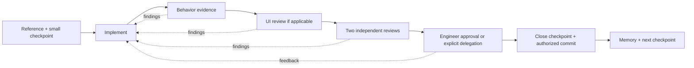

<div align="center">

# Loxihart Ratchet

**Small checkpoints. Evidence before progress.**

A portable engineering workflow for AI coding agents. Like a ratchet, work only advances once a checkpoint fully seats: proven behavior, matched UI, two independent reviews, and approval. Inspired by Shopify's Helix.

[Español](README.es.md) · [Install](docs/installation.md) · [Method](docs/method.md) · [Example](examples/checkpoint-walkthrough.md) · [Sources](docs/sources.md)


</div>

Loxihart Ratchet helps an agent make a small change, demonstrate its behavior, review it, fix the findings, and preserve what was learned before starting the next change. Use it for migrations, refactors, and substantial features.

**Loxihart fork.** Loxihart Ratchet is the Loxihart (Abstrekkt) adaptation of [jaleco8/helix-skills](https://github.com/jaleco8/helix-skills) at commit `25ff07b` (v0.1.0), renamed and rebranded for use across Loxihart builds. Upstream is MIT licensed; its copyright notice is retained in every LICENSE file.

**Independent community implementation.** This is not Shopify's internal Helix, an official Shopify release, or a reproduction of its infrastructure. The workflow follows the [published Helix method](https://shopify.engineering/helix); the installer, ledger, templates, and portability decisions are original to this project.

## Start in your existing project

Requirements: Python 3.10+. Git is also required for the optional evidence ledger. No API key or Python package is needed to install or use the helper.

```bash
git clone https://github.com/Krosebrook/loxihart-ratchet.git
cd loxihart-ratchet
python3 scripts/install.py --agent codex --project /absolute/path/to/your-project
```

Open your coding agent in **your project** and ask:

> Use Ratchet to implement this change: [your request]. Start with the smallest verifiable checkpoint. Show the evidence and outstanding gates before moving on.

For other agents, replace `codex` with `claude`, `antigravity`, `gemini`, `grok`, `opencode`, `kimi`, `qwen`, or `copilot`. Run with `--dry-run` to preview file destinations. The installer copies all six skills and their resources, preserves existing configuration, and refuses to overwrite different skills. [Installation and upgrades →](docs/installation.md)

For Claude Code, the repository is also a plugin marketplace:

```text
/plugin marketplace add Krosebrook/loxihart-ratchet
/plugin install loxihart-ratchet@loxihart-ratchet
```

In Codex, invoke `$ratchet` after project installation. Natural-language invocation is the portable entry point.

**Slash commands (Claude Code and Cowork).** Every skill is also a slash command; there is no separate `commands/` folder.

| Step | Command |
| --- | --- |
| Run a change through the full loop | `/loxihart-ratchet:ratchet` |
| Plan checkpoints only | `/loxihart-ratchet:ratchet-plan` |
| Collect behavior evidence | `/loxihart-ratchet:ratchet-behavior` |
| Compare UI against the reference | `/loxihart-ratchet:ratchet-ui-review` |
| Run one independent review | `/loxihart-ratchet:ratchet-adversarial-review` |
| Record lessons or resume | `/loxihart-ratchet:ratchet-memory` |

**Cowork.** Zip `plugins/loxihart-ratchet/` and upload it under Personal Plugins, or install it from this marketplace. If you installed the earlier `ratchet` plugin, uninstall it: this marketplace maps `ratchet` to `loxihart-ratchet`, so installs made through it migrate automatically, but an uploaded `ratchet.plugin` does not.

## The loop



A code or plan change invalidates the current evidence in the helper. Missing tools or reviewers remain visible blockers. Logic-only checkpoints can omit UI review with a recorded reason. Human approval is the default; an explicit, bounded delegation can cover named checkpoints without weakening technical gates.

## Six focused skills

| Skill | Responsibility |
| --- | --- |
| [`ratchet`](plugins/loxihart-ratchet/skills/ratchet/SKILL.md) | Run the checkpoint loop and manage evidence |
| [`ratchet-plan`](plugins/loxihart-ratchet/skills/ratchet-plan/SKILL.md) | Choose a reference, small scope, and observable acceptance criteria |
| [`ratchet-behavior`](plugins/loxihart-ratchet/skills/ratchet-behavior/SKILL.md) | Demonstrate behavior with tests and runtime observations |
| [`ratchet-ui-review`](plugins/loxihart-ratchet/skills/ratchet-ui-review/SKILL.md) | Compare equivalent reference/candidate visual states |
| [`ratchet-adversarial-review`](plugins/loxihart-ratchet/skills/ratchet-adversarial-review/SKILL.md) | Challenge the implementation in separate reviewer sessions |
| [`ratchet-memory`](plugins/loxihart-ratchet/skills/ratchet-memory/SKILL.md) | Preserve accepted decisions and resume context |

Skills use the [Agent Skills format](https://agentskills.io/specification). They are instructions and supporting resources; the host agent supplies execution, vision, and review capabilities.

## Agent compatibility

| Agent surface | Installation target in your project | Delivery |
| --- | --- | --- |
| Codex | `.agents/skills/` | Skills + bundled Codex plugin manifest |
| Claude Code | `.claude/skills/` | Skills or marketplace plugin |
| Antigravity | `.agents/skills/` | Skills |
| Gemini CLI | `.gemini/skills/` | Skills |
| Grok Build | `.grok/skills/` | Skills |
| OpenCode | `.opencode/skills/` | Skills |
| Kimi Code | `.agents/skills/` | Skills |
| Qwen Code | `.qwen/skills/` | Skills |
| GitHub Copilot | `.github/skills/` | Skills |

Paths are based on official documentation checked on September 24, 2026. Installer behavior and local ledger invariants are tested; **end-to-end sessions inside all nine agent surfaces have not been tested**. A model name alone does not imply skill or tool support. Grok here means Grok Build, and Gemini means Gemini CLI or Antigravity. [Compatibility details and sources →](docs/compatibility.md)

## Evidence ledger

The bundled Python helper records a content snapshot and ordered gate reports. It checks that required artifacts exist and remain unchanged, rejects stale reports, detects declared self-review, and refuses to close an incomplete checkpoint. It makes no model calls and never commits, pushes, or runs a shell command from a report.

```bash
python3 plugins/loxihart-ratchet/skills/ratchet/scripts/checkpoint.py --help
```

[Walk through a checkpoint →](examples/checkpoint-walkthrough.md)

The ledger is a local bookkeeping tool, **not a tamper-proof enforcement system**. Report content, session identities, approval authority, and test quality still require honest tools and reviewers. Add CI and branch protection when you need enforcement outside the agent. It does not launch subagents, capture screens, call visual models, or run unattended jobs by itself.

## Repository layout

```text
plugins/loxihart-ratchet/     # Self-contained Codex/Claude plugin and six skills
scripts/install.py       # Project-scoped installer, standard library only
scripts/validate.py      # Package and reference validation
examples/                # Worked usage and review packet
tests/                   # Ledger and installer behavioral tests
docs/                    # Method, compatibility, installation, provenance
```

## Contribute

```bash
python3 -m pip install -r requirements-dev.txt
python3 scripts/validate.py
python3 -m unittest discover -s tests -v
```

See [CONTRIBUTING.md](CONTRIBUTING.md) for scope and behavioral evaluation scenarios. Runtime data lives in the target project's `.ratchet/` directory; keep it private and out of Git unless you intentionally sanitize it for sharing.

MIT licensed. Credit to [Shopify Engineering](docs/sources.md) for the published workflow and to [career-ops](https://github.com/career-ops-hq/career-ops) for the example of a portable, agent-operated project. No source code or article text was copied from either project.
